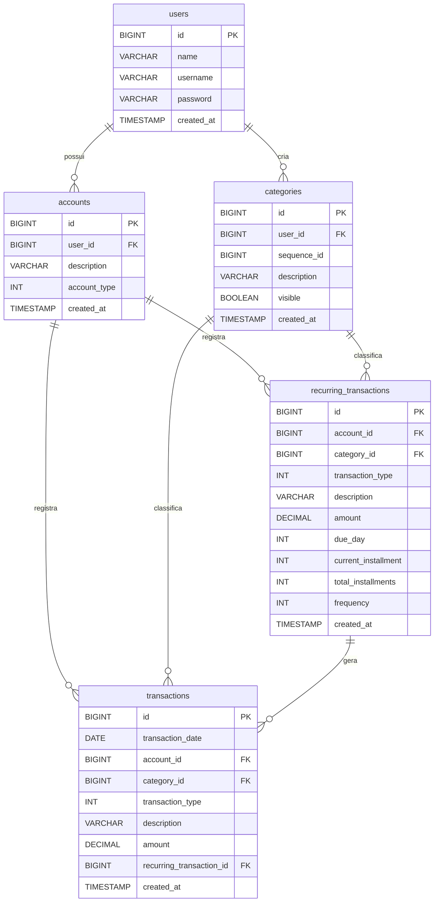

# Izzy Financs 💰


Izzy Financs é uma API RESTful para gestão financeira pessoal. O objetivo deste projeto é fornecer uma plataforma simples e eficiente para que os usuários possam gerenciar suas contas, categorias de gastos, e registrar transações financeiras (receitas e despesas).

## 🚀 Funcionalidades

- **Gerenciamento de Usuários:** Cadastro e controle de perfis.
- **Gestão de Contas:** Criação e acompanhamento de contas bancárias/carteiras.
- **Categorização:** Organização de receitas e despesas por categorias.
- **Transações Financeiras:** Registro de entradas e saídas.
- **Transações Recorrentes:** Suporte a lançamentos que se repetem (ex: assinaturas).

## 🛠️ Tecnologias Utilizadas

- **Java 21**
- **Spring Boot** (Web, Data JPA, Validation)
- **MySQL** (Banco de dados relacional)
- **Lombok** (Redução de boilerplate de código)
- **Maven** (Gerenciador de dependências)

## 📋 Pré-requisitos

Antes de começar, você precisará ter instalado em sua máquina as seguintes ferramentas:
- [Java JDK 21](https://www.oracle.com/java/technologies/javase/jdk21-archive-downloads.html)
- [Maven](https://maven.apache.org/)
- [MySQL](https://www.mysql.com/)

## ⚙️ Como Executar o Projeto

1. Clone este repositório:
   ```bash
   git clone https://github.com/gif26/izzy-financs.git
   ```

2. Acesse a pasta do projeto no terminal/cmd:
   ```bash
   cd izzy-financs
   ```

3. Crie um banco de dados no MySQL chamado `financial_manager`:
   ```sql
   CREATE DATABASE financial_manager;
   ```

4. **(Opcional - Criação Manual das Tabelas):** O projeto utiliza o Hibernate para mapear e gerar as tabelas. Porém, na pasta `src/main/resources/Scripts` você encontra os scripts SQL originais para a criação estrutural do banco caso prefira executá-los manualmente em seu cliente de banco de dados.

5. Configure as credenciais do banco de dados no arquivo `src/main/resources/application.properties`:
   ```properties
   spring.datasource.url=jdbc:mysql://localhost:3306/financial_manager
   spring.datasource.username=SEU_USUARIO_AQUI (padrão: root)
   spring.datasource.password=SUA_SENHA_AQUI (padrão: root)
   ```

5. Execute a aplicação usando o Maven:
   ```bash
   ./mvnw spring-boot:run
   ```

6. O servidor iniciará na porta `8080`. Você pode acessar a API em: `http://localhost:8080`

## 📖 Documentação da API (Swagger)

A API está documentada utilizando o **Swagger (OpenAPI 3)**. Para visualizar os endpoints disponíveis, testar requisições e ver os formatos de dados (schemas) esperados:

1. Certifique-se de que a aplicação está rodando.
2. Acesse no seu navegador: [http://localhost:8080/swagger-ui.html](http://localhost:8080/swagger-ui.html)

Isso proporciona uma interface interativa excelente para testes e consumo da API!

## 🗄️ Modelo Relacional (ERD)

Abaixo está o modelo entidade-relacionamento (Diagrama ER) do banco de dados:



## 📁 Estrutura do Projeto

A arquitetura do projeto segue o padrão em camadas (Layered Architecture):

- `controller`: Responsável por receber as requisições HTTP e retornar as respostas.
- `service`: Contém as regras de negócio da aplicação.
- `repository`: Interfaces de comunicação com o banco de dados (Spring Data JPA).
- `model`: Entidades de domínio que mapeiam as tabelas do banco de dados.
- `dto`: Objetos de Transferência de Dados (Data Transfer Objects) usados nas requisições e respostas.
- `enums`: Enumerações utilizadas no sistema.

## 🤝 Contribuindo

Este projeto é desenvolvido para fins de portfólio, mas feedbacks e sugestões de melhoria são sempre bem-vindos!

1. Faça um *fork* do projeto.
2. Crie uma nova branch com as suas alterações: `git checkout -b my-feature`
3. Salve as alterações e crie uma mensagem de commit contando o que você fez: `git commit -m "feature: My new feature"`
4. Envie as suas alterações: `git push origin my-feature`

